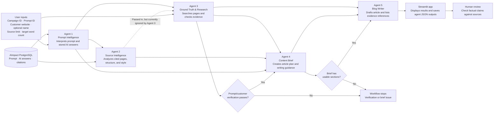

# Current Agent Workflow

## Notes

- Streamlit runs the five-agent workflow through LangGraph.
- Agents 1 and 2 independently read prompt evidence from the database. Their current score thresholds are 70 and 1000; the meaning and rationale for the difference have not been confirmed.
- Agent 2 analyzes pages cited in the stored AI answers. Agent 3 conducts separate web research and currently does not use Agent 2's output.
- Agent 2 provides source/content observations, not independent fact-checking.
- The workflow creates a draft; a person should verify claims and sources before publication.
